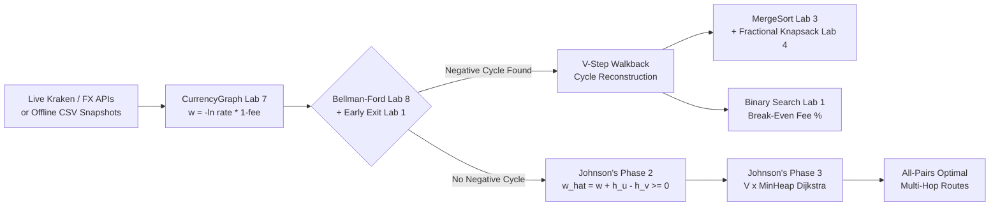

# ArbiGraph — Real-Time FX & Crypto Arbitrage + Multi-Hop Currency Routing Engine


**ArbiGraph** is an algorithmic quantitative finance engine built **100% from scratch in pure Python** (zero external algorithm, graph, or web-framework dependencies). It models live global foreign exchange (FX) and cryptocurrency orderbooks as directed logarithmic graphs to solve two coupled market problems:

1. **Arbitrage Detection Mode (`Bellman–Ford`):** Detects and reconstructs risk-free negative-weight trade loops ($3$-hop, $4$-hop, and $5$-hop cycles), computes the exact **break-even broker fee** via **Binary Search**, and allocates trader capital across liquidity-capped orderbooks using **MergeSort + Greedy Fractional Knapsack**.
2. **Equilibrium Routing Mode (`Johnson’s Algorithm`):** When markets are arbitrage-free, roughly **50% of edges still have negative weights** ($w = -\ln(\text{rate}) < 0$ whenever $\text{rate} > 1.0$, e.g., $1\text{ USD} = 119.75\text{ BDT}$), making plain Dijkstra illegal. ArbiGraph executes **Johnson’s 3-Phase Algorithm** (Bellman–Ford potentials $h(v)$ $\rightarrow$ non-negative edge reweighting $\hat{w}(u,v) \ge 0$ $\rightarrow$ $V \times$ Custom-MinHeap **Dijkstra**) to discover optimal multi-hop conversion routes in $O(V^2 \log V + VE)$ time.

---

## Mathematical Foundation

### 1. Converting Multiplicative Exchange Rates into Additive Graph Weights
Given directed conversion rate $R_{u \to v}$ and per-trade transaction fee $f \in [0, 1)$, the effective rate is $R^{\text{eff}}_{u \to v} = R_{u \to v}(1 - f)$. A closed currency loop $C = (v_1 \to v_2 \to \dots \to v_k \to v_1)$ yields risk-free profit if and only if:

$$\prod_{(u,v) \in C} R^{\text{eff}}_{u \to v} > 1 \iff \sum_{(u,v) \in C} \ln\!\left(R^{\text{eff}}_{u \to v}\right) > 0 \iff \sum_{(u,v) \in C} \underbrace{\left(-\ln R^{\text{eff}}_{u \to v}\right)}_{w(u,v)} < 0$$

* **Negative-weight cycle** $\sum w(u,v) < 0 \iff$ **Risk-free currency arbitrage**.
* **Shortest path** $\min \sum w(u,v) \iff$ **Maximum multi-hop conversion output** $\exp(-d(u,v))$.

### 2. Why Johnson’s Algorithm Is Essential for Calm Currency Markets
Even with zero arbitrage, every pair with $R^{\text{eff}}_{u \to v} > 1$ produces $w(u,v) < 0$, breaking Dijkstra’s greedy invariant. **Johnson’s Algorithm** resolves this in three phases:
1. **Phase 1 (Bellman–Ford from Virtual Node $q$):** Computes shortest-path potentials $h(v)$ from a zero-weight super-source $q$ (or halts immediately if a negative cycle exists).
2. **Phase 2 (Potential Reweighting):** Transforms every edge weight via:
   $$\hat{w}(u, v) = w(u, v) + h(u) - h(v) \ge 0$$
   Because intermediate potentials telescope along any path $P = (v_0 \to \dots \to v_k)$, $\hat{w}(P) = w(P) + h(v_0) - h(v_k)$, preserving exact shortest paths while guaranteeing $\hat{w}(u,v) \ge 0$.
3. **Phase 3 ($V \times$ Custom-MinHeap Dijkstra):** Runs $O((V + E)\log V)$ Dijkstra from each currency and inverts the potential shift: $d(u,v) = \hat{d}(u,v) - h(u) + h(v)$.

---

## Architecture & Algorithm Pipeline



---

## CSE246 Algorithm Mapping (100% Implemented From Scratch)

| Module File | Algorithm / Data Structure | Syllabus Lab | Complexity | Purpose in ArbiGraph |
| :--- | :--- | :---: | :---: | :--- |
| `algorithms/graph.py` | Directed Graph (Edge List, Adj List, Matrix) | **Lab 7** | $O(V + E)$ | Synchronizes log-transformed currency quotes |
| `algorithms/min_heap.py` | Binary `MinHeap` Priority Queue | **Lab 7 / 8** | $O(\log V)$ | Powers Dijkstra without Python's `heapq` |
| `algorithms/bellman_ford.py` | Bellman–Ford + Early Exit + $V$-Step Cycle Trace | **Lab 8 + Lab 1** | $O(V \cdot E)$ | Detects & reconstructs $k$-hop arbitrage cycles |
| `algorithms/johnsons.py` | Johnson’s APSP (`BF` + Reweighting + `Dijkstra`) | **Lab 8** | $O(V^2\log V + VE)$ | Optimal multi-hop currency routing with negative edges |
| `algorithms/floyd_warshall.py` | Floyd–Warshall Dynamic Programming APSP | **Lab 8** | $O(V^3)$ | Cross-checks Johnson’s to $10^{-12}$ & benchmarks scaling |
| `algorithms/optimizations.py` | Divide-and-Conquer `merge_sort` | **Lab 3** | $O(N \log N)$ | Ranks arbitrage loops & multi-hop savings by ROI |
| `algorithms/optimizations.py` | Binary Search on Monotonic Fee | **Lab 1** | $O(V E \log \frac{1}{\epsilon})$ | Pinpoints exact broker fee where arbitrage vanishes |
| `algorithms/optimizations.py` | Greedy Fractional Knapsack | **Lab 4** | $O(N \log N)$ | Splits trader budget across orderbook liquidity caps |
| `algorithms/optimizations.py` | Brute-Force 3-Hop Scanner | **Lab 1** | $O(V^3)$ | Baseline proving Bellman–Ford catches $4/5$-hop loops missed by 3-hop brute force |

---

## Quick Start (Zero Installation Needed)

Requires only **Python 3.10+** (uses zero external packages).

### 1. Launch the Interactive Web Quant Dashboard
```bash
python3 app.py --port 8000
```
Then open **`http://localhost:8000`** in your browser to explore:
* Interactive animated SVG Currency Network Graph
* Live Kraken Bid/Ask Orderbook & Global FX + `BDT` API feeds (plus offline-safe CSV snapshots)
* Real-time Transaction Fee Slider & Professor Live Rate Sandbox
* Johnson’s Potential Reweighting Inspector & Live $V = 15 \to 160$ Scaling Benchmark Chart

### 2. Run the Terminal CLI
```bash
# Scan institutional FX desk snapshot for multi-hop arbitrage
python3 cli.py --dataset fx_arbitrage_desk --capital 1000 --fee 0.0

# Find optimal multi-hop conversion route for 100,000 BDT -> EUR using Johnson's Algorithm
python3 cli.py --dataset bdt_remittance_corridor --capital 100000 --from-cur BDT --to-cur EUR

# Scan LIVE Kraken crypto/fiat executable Bid/Ask orderbook
python3 cli.py --dataset live_kraken --fee 0.0

# Run empirical scaling benchmark (Johnson's vs Floyd-Warshall up to V=160 currencies)
python3 cli.py --benchmark
```

### 3. Run Unit Tests
```bash
python3 -m unittest discover -s tests -v
```

---

## Repository Structure

```text
ArbiGraph/
├── app.py                        # Zero-dependency HTTP server + JSON API (0.0.0.0:8000)
├── cli.py                        # ANSI-formatted terminal CLI & benchmark runner
├── arbigraph/
│   ├── algorithms/               # 100% from-scratch CSE246 algorithm implementations
│   │   ├── graph.py              # Lab 7: CurrencyGraph (-ln transform)
│   │   ├── min_heap.py           # Custom Binary Min-Heap priority queue
│   │   ├── bellman_ford.py       # Lab 8 + Lab 1: Negative cycle detection & reconstruction
│   │   ├── dijkstra.py           # Lab 8: Single-source shortest paths on w_hat >= 0
│   │   ├── johnsons.py           # Lab 8: 3-phase Johnson's All-Pairs currency router
│   │   ├── floyd_warshall.py     # Lab 8: O(V^3) DP cross-check & benchmark baseline
│   │   ├── optimizations.py      # Labs 1, 3, 4: MergeSort, Binary Search Fee, Knapsack
│   │   └── benchmark.py          # Sparse FX graph generator & scaling benchmark
│   ├── services/
│   │   ├── market_data.py        # Live Kraken & ER-API/ECB fetchers + CSV loader
│   │   └── engine.py             # End-to-end quantitative analysis pipeline
│   └── web/                      # Dark-mode Quant Dashboard (HTML + CSS + SVG + JS)
├── data/                         # Offline-safe FX, BDT Remittance & Crypto CSV snapshots
├── docs/
│   └── VIVA_GUIDE.md             # Key viva questions & mathematical answers
└── tests/
    └── test_algorithms.py        # Automated unit tests for every algorithm
```
